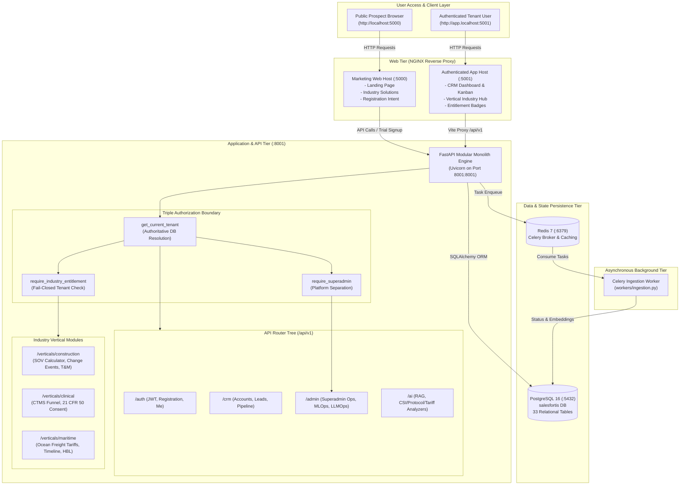

# 01 — System Architecture Overview

## 1. High-Level System Architecture Diagram

---

## 2. Implementation Status: Existing vs. Planned

| Subsystem | Existing Implementation | Planned Architecture |
| :--- | :--- | :--- |
| **Port Routing** | FastAPI running on `8001:8001`. Web running on `5000:80` (Marketing) and `5001:80` (CRM App). | Production domain routing (`www.salesfortis.com` and `app.salesfortis.com`) via Cloudflare. |
| **Authentication** | JWT Bearer tokens with server-side authoritative tenant extraction. No spoofing possible. | Enterprise SAML 2.0 / Okta SSO, OAuth2 Social Providers. |
| **Vertical Modules** | Fully mounted routers under `/api/v1/verticals/{construction,clinical,maritime}` protected by fail-closed dependency injection. | Industry-specific webhook receivers and external partner API integrations. |
| **Background Processing** | Celery worker with synchronous mock fallback during development/testing. | Dedicated queue isolation: `ingestion_queue`, `llm_scoring_queue`, `notification_queue`. |

