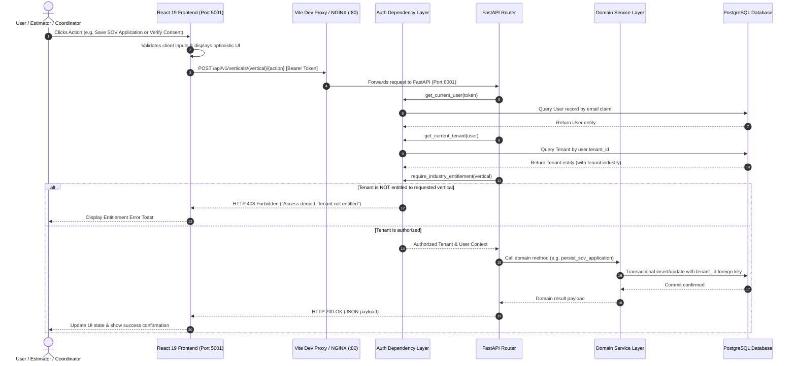
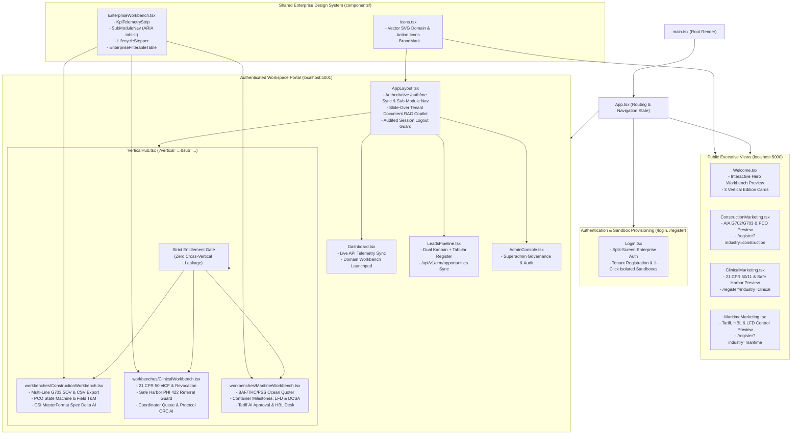

# 02 — Frontend-to-Backend Runtime Architecture

## 1. Runtime Execution & Request Flow

---

## 2. Frontend Component Hierarchy (`apps/web/src`)

---

## 3. Implementation Status: Existing vs. Planned

| Layer | Existing Implementation | Planned Architecture |
| :--- | :--- | :--- |
| **Vite / Nginx Proxy** | Configured in `apps/web/vite.config.ts` (`:5001` / `:4173`) and `infra/nginx.conf` (`:5000` / `:5001` in Docker): `/api` forwards to FastAPI (`:8001`). | Production multi-domain DNS resolution (`www.salesfortis.com` / `app.salesfortis.com`) with automated TLS. |
| **State Management** | React 19 hooks (`useState`, `useEffect`, `useSearchParams`) synced with live FastAPI/PostgreSQL endpoints plus resilient preview fallback. | Optimistic cache invalidation and real-time WebSocket event push. |
| **Design System & Workbenches** | Original SalesFortis enterprise design tokens (`Inter` + `JetBrains Mono` tabular numerals), vector `Icons.tsx`, reusable `EnterpriseWorkbench.tsx` primitives (ARIA `tablist`, searchable/filterable data tables, lifecycle steppers), and 3 deep isolated workbenches verified via REA (`ev_fe2e126d...`) and 16 Playwright E2E tests. | Tenant-customizable white-label theme tokens and printable AIA G702/G703 & HBL PDF export templates. |

