# 03 — Relational Database Entity-Relationship (ER) Model

## 1. Complete Database Entity-Relationship Diagram
The SalesFortis relational schema contains **33 tables** migrated up to Alembic revision `c7f1a8e2d39b`:

```mermaid
erDiagram
    %% Core Authentication & Multi-Tenancy
    tenants ||--o{ users : "owns"
    tenants ||--o{ audit_logs : "records"
    tenants ||--o{ accounts : "owns"
    tenants ||--o{ leads : "owns"
    tenants ||--o{ opportunities : "owns"

    tenants {
        uuid id PK
        string name
        string slug
        string industry "construction | clinical | maritime | all | NULL"
        string subscription_tier
        string status
        timestamp created_at
    }

    users {
        uuid id PK
        uuid tenant_id FK
        string email
        string hashed_password
        string first_name
        string last_name
        boolean is_superadmin
        string status
        timestamp created_at
    }

    audit_logs {
        uuid id PK
        uuid tenant_id FK
        uuid user_id FK
        string action
        string entity_name
        string entity_id
        json details
        timestamp created_at
    }

    %% Core CRM
    accounts ||--o{ contacts : "has"
    accounts ||--o{ opportunities : "generates"
    leads ||--o{ opportunities : "converts_to"

    accounts {
        uuid id PK
        uuid tenant_id FK
        string name
        string industry
        string status
        float annual_revenue
        timestamp created_at
    }

    leads {
        uuid id PK
        uuid tenant_id FK
        string first_name
        string last_name
        string company
        string email
        string status
        float lead_score
        timestamp created_at
    }

    opportunities {
        uuid id PK
        uuid tenant_id FK
        uuid account_id FK
        string name
        string stage
        float amount
        float probability
        timestamp expected_close_date
    }

    %% Construction Industry Vertical
    tenants ||--o{ construction_projects : "owns"
    construction_projects ||--o{ sov_applications : "bills"
    construction_projects ||--o{ change_events : "incurs"
    construction_projects ||--o{ field_time_materials : "tracks"
    sov_applications ||--o{ sov_line_items : "contains"
    change_events ||--o{ potential_change_orders : "escalates_to"
    change_events ||--o{ field_time_materials : "justified_by"

    construction_projects {
        uuid id PK
        uuid tenant_id FK
        string name
        string project_number
        string general_contractor
        float total_contract_value
        string status
    }

    sov_applications {
        uuid id PK
        uuid tenant_id FK
        uuid project_id FK
        int application_number
        float total_contract_value
        float total_completed_stored
        float total_retainage
        float net_payment_due
        string status
        timestamp period_to
    }

    sov_line_items {
        uuid id PK
        uuid tenant_id FK
        uuid application_id FK
        string line_item_id
        string description
        float scheduled_value
        float work_previous
        float work_current
        float stored_materials
        float total_completed
        float retainage_amount
    }

    change_events {
        uuid id PK
        uuid tenant_id FK
        uuid project_id FK
        string event_number
        string title
        string trade_scope
        float estimated_cost
        string status "draft | under_review | approved | rejected"
    }

    field_time_materials {
        uuid id PK
        uuid tenant_id FK
        uuid project_id FK
        uuid change_event_id FK
        string worker_name
        string trade
        float hours_worked
        float materials_cost
        float equipment_cost
        timestamp work_date
    }

    potential_change_orders {
        uuid id PK
        uuid tenant_id FK
        uuid project_id FK
        uuid change_event_id FK
        string pco_number
        float proposed_amount
        string status
    }

    %% Clinical CTMS Industry Vertical
    tenants ||--o{ clinical_studies : "conducts"
    clinical_studies ||--o{ clinical_sites : "operates_at"
    clinical_studies ||--o{ clinical_referrals : "screens"
    clinical_studies ||--o{ eligibility_criteria : "specifies"
    clinical_referrals ||--o{ consent_evidence : "evidenced_by"
    clinical_referrals ||--o{ follow_up_tasks : "schedules"

    clinical_studies {
        uuid id PK
        uuid tenant_id FK
        string protocol_number
        string title
        string phase
        int target_enrollment
        int current_enrolled
        string status
    }

    clinical_sites {
        uuid id PK
        uuid tenant_id FK
        uuid study_id FK
        string site_name
        string site_number
        string pi_name
        string status
    }

    clinical_referrals {
        uuid id PK
        uuid tenant_id FK
        uuid study_id FK
        uuid site_id FK
        string pseudonymous_id
        string stage "identified | prescreened | consented | randomized | withdrawn"
        string consent_status "pending | verified | revoked"
        timestamp consent_timestamp
    }

    consent_evidence {
        uuid id PK
        uuid tenant_id FK
        uuid referral_id FK
        string document_hash
        string ip_address
        string consent_version
        boolean is_valid
        timestamp signed_at
    }

    eligibility_criteria {
        uuid id PK
        uuid tenant_id FK
        uuid study_id FK
        string criteria_type "inclusion | exclusion"
        string criterion_description
        string protocol_citation
    }

    follow_up_tasks {
        uuid id PK
        uuid tenant_id FK
        uuid referral_id FK
        string task_type
        timestamp due_date
        string status
    }

    %% Maritime Freight Logistics Industry Vertical
    tenants ||--o{ ocean_tariffs : "maintains"
    tenants ||--o{ maritime_shipments : "tracks"
    tenants ||--o{ freight_quotations : "issues"
    ocean_tariffs ||--o{ carrier_surcharges : "applies"
    maritime_shipments ||--o{ milestone_events : "records"
    maritime_shipments ||--o{ house_bills_of_lading : "issues"

    ocean_tariffs {
        uuid id PK
        uuid tenant_id FK
        string carrier_name
        string trade_lane
        string container_type
        float base_rate
        string currency
        timestamp effective_date
        timestamp expiration_date
    }

    carrier_surcharges {
        uuid id PK
        uuid tenant_id FK
        uuid tariff_id FK
        string surcharge_code "BAF | THC | PSS"
        float amount
        string currency
    }

    freight_quotations {
        uuid id PK
        uuid tenant_id FK
        string quote_number
        string trade_lane
        string container_type
        int container_count
        float base_rate_per_unit
        float total_freight_quote
        string status
    }

    maritime_shipments {
        uuid id PK
        uuid tenant_id FK
        string booking_number
        string bl_number
        string vessel
        string voyage
        string origin_port
        string destination_port
        string status
        timestamp eta
        timestamp last_free_day
    }

    milestone_events {
        uuid id PK
        uuid tenant_id FK
        uuid shipment_id FK
        string milestone_code
        string port_or_location
        string status
        boolean detention_risk_flag
        timestamp event_timestamp
    }

    house_bills_of_lading {
        uuid id PK
        uuid tenant_id FK
        uuid shipment_id FK
        string hbl_number
        string shipper_name
        string consignee_name
        float gross_weight_kg
        float measurement_cbm
        timestamp issue_date
    }
```

---

## 2. Implementation Status: Existing vs. Planned

| Domain Model Group | Existing Implementation | Planned Architecture |
| :--- | :--- | :--- |
| **Multi-Tenancy** | Fail-closed tenant isolation. Foreign key `tenant_id` on all 33 tables. Indexed query filters. | Row Level Security (RLS) PostgreSQL policies with tenant session variables. |
| **Alembic Revisions** | `b6e8f38db826` (vertical domain tables) and `c7f1a8e2d39b` (`industry` column in `tenants`). | Zero-downtime blue/green schema migration scripts. |
| **Audit Trails** | `audit_logs` model and transactional commit records. | Immutable cryptographically-hashed write-ahead audit event log. |

