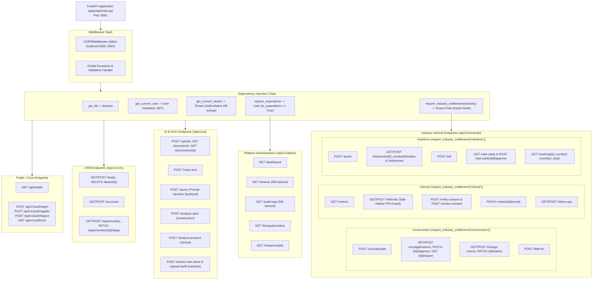

# 04 — API & Service Layer Architecture

## 1. FastAPI Route Hierarchy & Dependencies

---

## 2. Service Layer Class Diagram

```mermaid
classDiagram
    class ConstructionSOVService {
        +calculate_sov_application(lines, retainage_rate_pct) Dict
        +persist_sov_application(db, tenant_id, project_id, ...) SOVApplication
        +list_sov_applications(db, tenant_id, project_id) List
        +create_change_event(db, tenant_id, ...) ChangeEvent
        +update_change_event_status(db, tenant_id, id, status) ChangeEvent
        +log_field_tm(db, tenant_id, ...) FieldTimeMaterial
    }

    class ClinicalComplianceService {
        +get_or_create_demo_study(db, tenant_id) Study
        +get_funnel_metrics(db, tenant_id, study_id) Dict
        +list_referrals(db, tenant_id, study_id) List
        +verify_and_randomize(db, tenant_id, patient_id, consent_signed, user_id) Dict
        +create_followup_task(db, tenant_id, ...) FollowUpTask
    }

    class MaritimeFreightService {
        +calculate_freight_quote(db, tenant_id, trade_lane, ...) Dict
        +get_shipment_timeline(db, tenant_id, bl_number) Dict
        +generate_house_bill_of_lading(db, tenant_id, ...) HouseBillOfLading
        +check_demurrage_risk(db, tenant_id, bl_number) Dict
    }

    class RAGService {
        -_vector_store: Dict
        +chunk_text(text, chunk_size, chunk_overlap) List~str~
        +index_document(tenant_id, document_id, filename, text) int
        +query(tenant_id, query_text, top_k) Dict
    }
```

---

## 3. Implementation Status: Existing vs. Planned

| Component | Existing Implementation | Planned Architecture |
| :--- | :--- | :--- |
| **Dependency Injection** | Strict hierarchy: `get_current_tenant` authoritatively verifies tenant before router execution. | Scoped request context carrying audit correlation IDs and execution spans. |
| **Service Layer Pattern** | Modular service classes in `modules/*/service.py` decoupling business logic from HTTP handlers. | Domain Event Bus broadcasting asynchronous change events to Celery / Webhooks. |
| **API Versioning** | Standard prefix `/api/v1/`. | API rate-limiting per subscription tier via Redis token bucket. |

