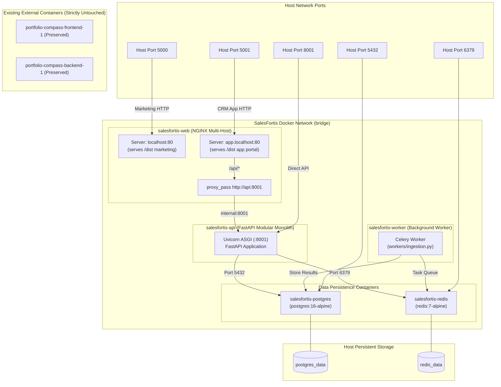

# 05 — Docker Infrastructure & Container Topology

## 1. Local Multi-Host Docker Topology Diagram

---

## 2. Port Allocation & Healthcheck Register

| Service Container | Context / Dockerfile | Internal Port | Host Port | Healthcheck Specification |
| :--- | :--- | :--- | :--- | :--- |
| `salesfortis-web` | `infra/Dockerfile.web` | `80` | `5000:80`, `5001:80` | `wget -qO- http://localhost:80/ > /dev/null \|\| exit 1` |
| `salesfortis-api` | `infra/Dockerfile.api` (includes `workers/`) | `8001` | `8001:8001` | `curl -f http://localhost:8001/api/health \|\| exit 1` |
| `salesfortis-worker` | `infra/Dockerfile.worker` | - | - | Dependent on `postgres` & `redis` health |
| `salesfortis-postgres` | `postgres:16-alpine` | `5432` | `127.0.0.1:5432:5432` (Loopback Only) | `pg_isready -U salesfortis -d salesfortis` |
| `salesfortis-redis` | `redis:7-alpine` | `6379` | `127.0.0.1:6379:6379` (Loopback Only) | `redis-cli ping` |

---

## 3. Strict Non-Destructive Operation Rules
- **No Global Prunes**: Commands like `docker system prune`, `docker stop $(docker ps -q)`, or `docker rm -f` are strictly prohibited.
- **Explicit Project Scoping**: All compose commands must explicitly specify the compose file:
  `docker compose -f infra/docker-compose.dev.yml up -d`
- **External Container Protection**: Existing running or stopped containers (e.g. `portfolio-compass-*`) are completely isolated on their own networks and will never be modified or stopped.

