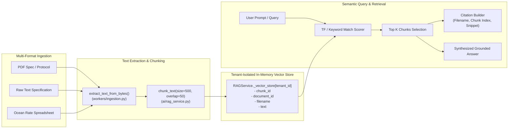
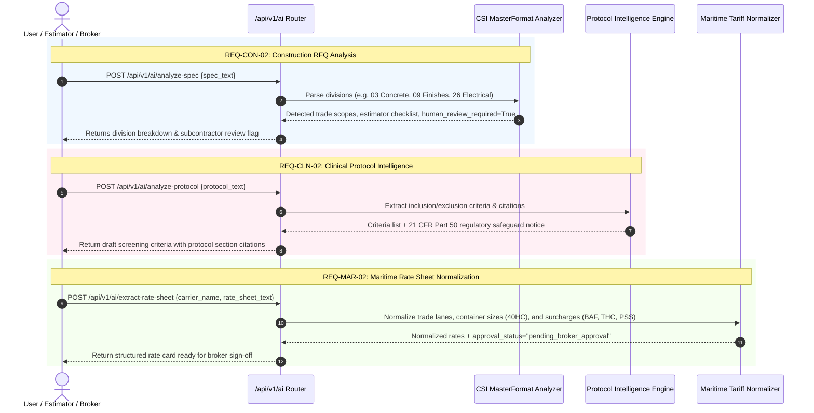

# 06 — AI & Document RAG Pipeline Architecture

## 1. Document Ingestion & Retrieval Pipeline

---

## 2. Specialized Vertical AI Processors (`ai/router.py`)

---

## 3. Implementation Status: Existing vs. Planned

| Feature | Existing Implementation | Planned Architecture |
| :--- | :--- | :--- |
| **Indexing Engine** | SQLAlchemy `Document` + `DocumentChunk` persistence synchronized with tenant-isolated in-memory TF scorer and strict `GET /documents/{id}` tenant authorization. | PGVector or Qdrant vector database with HNSW indexes and multi-tenant partitioning. |
| **Prompt Injection & Guardrails** | Regex prompt-injection sanitizer (`sanitize_prompt_injection`) + Triple-boundary `require_industry_entitlement` on all 3 vertical AI endpoints. | LLM-based input/output classifier sidecar + LiteLLM embedding proxy. |
| **Human-in-the-Loop** | CSI addendum comparison (`previous_spec_text`), persisted draft `EligibilityCriteria` (`PATCH /criteria/{id}/verify`), and staged `RateCard` (`POST /rate-cards/{id}/approve`) before live quoting. | Multi-step interactive review wizard with differential PDF highlighting. |

