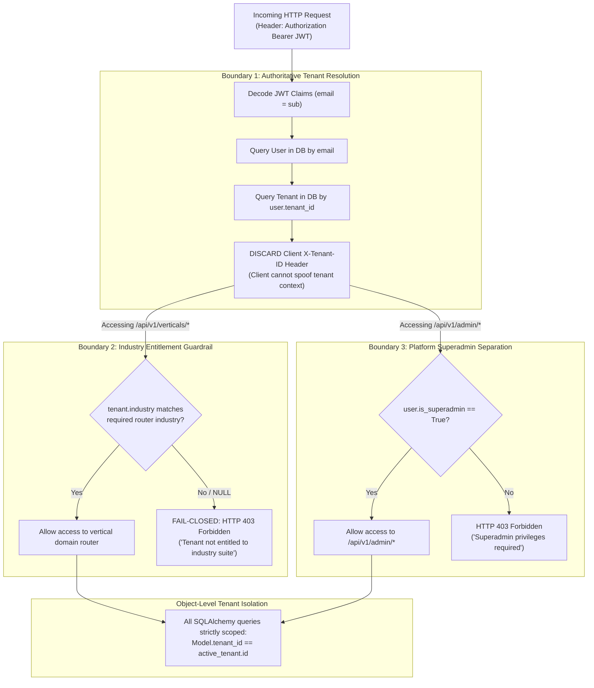

# 07 — Triple-Boundary Security & Isolation Architecture

## 1. Triple Authorization Boundaries Diagram

---

## 2. Security Decision Matrix

| Request Scenario | Authenticated Context | Requested Endpoint | Enforcement Mechanism | HTTP Response |
| :--- | :--- | :--- | :--- | :--- |
| **Cross-Industry Access** | Construction Tenant (`industry="construction"`) | `GET /api/v1/verticals/clinical/metrics` | `require_industry_entitlement("clinical")` | **HTTP 403 Forbidden** |
| **Cross-Industry Access** | Clinical Tenant (`industry="clinical"`) | `POST /api/v1/verticals/construction/sov/applications` | `require_industry_entitlement("construction")` | **HTTP 403 Forbidden** |
| **Fail-Closed Unassigned** | Unassigned Tenant (`industry=None`) | `GET /api/v1/verticals/maritime/shipments/...` | `require_industry_entitlement("maritime")` | **HTTP 403 Forbidden** |
| **Header Spoofing** | Tenant B User with header `X-Tenant-ID: Tenant-A` | `GET /api/v1/crm/accounts` | `get_current_tenant` ignores header; queries DB `user.tenant_id` | **HTTP 200 OK (Scoped strictly to Tenant B)** |
| **Superadmin Escalation** | Tenant Administrator (`is_superadmin=False`) | `GET /api/v1/admin/dashboard` | `require_superadmin` dependency | **HTTP 403 Forbidden** |
| **Cross-Tenant Data Tampering** | Tenant B User requests Tenant A SOV Application ID | `GET /api/v1/verticals/construction/sov/applications` | Query filter `SOVApplication.tenant_id == tenant.id` | **Zero rows returned / 404** |

---

## 3. Implementation Status: Existing vs. Planned

| Security Feature | Existing Implementation | Planned Architecture |
| :--- | :--- | :--- |
| **Tenant Derivation** | Fully implemented in `core/services/auth_service.py` via `get_current_tenant`. Verified by 5 negative security tests. | Multi-factor authentication (MFA) verification gate per tenant session. |
| **Fail-Closed Entitlement** | Database column `industry` in `tenants` (Alembic `c7f1a8e2d39b`). Explicit entitlements only (`construction`, `clinical`, `maritime`, `all`). | Feature flag evaluation engine tied to Stripe subscription plans. |
| **Superadmin Separation** | Dedicated dependency `require_superadmin` protecting `/api/v1/admin` (including `/audit-logs` and `/tenants`). | Hardware security key (WebAuthn/FIDO2) superadmin step-up authentication. |
| **Operational Audit Trail** | `AuditService.record` persists `AuditLog` entries on SOV approvals/exports, consent verification/revocation, rate-card approvals, milestones, and HBL issuance. | Immutable cryptographically-chained external SIEM sink. |

