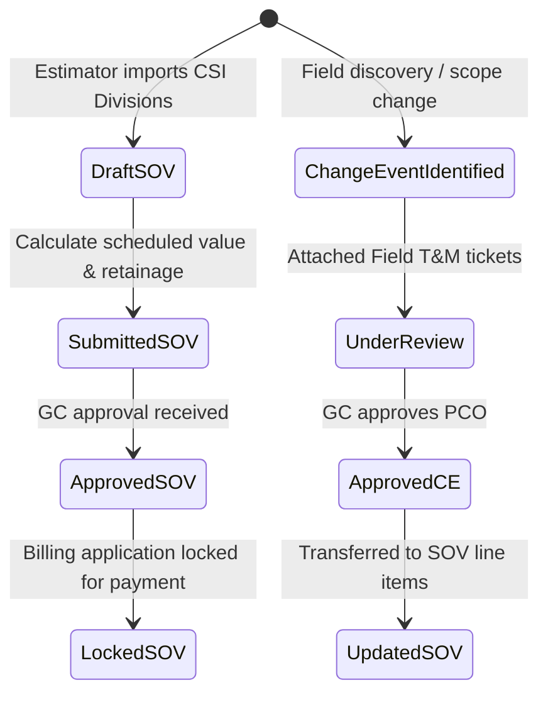
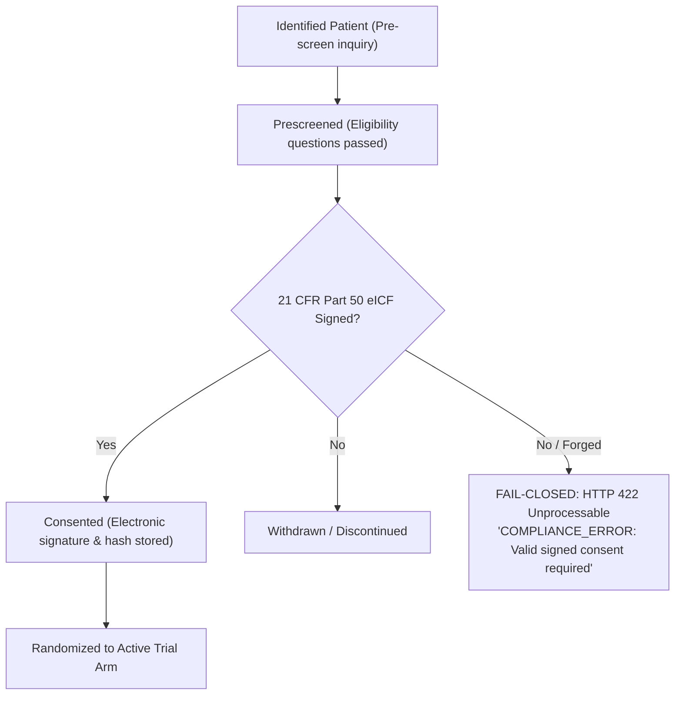
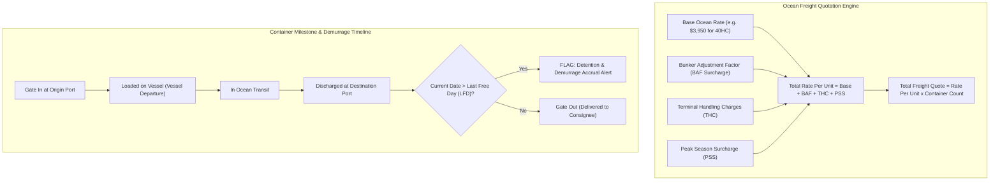

# 08 — Industry Vertical Modules Architecture

## 1. Commercial Subcontractor Construction Module

### 1.1 Architecture & Workflow

### 1.2 Math Formulas Implemented (`modules/construction/service.py`)
- **Total Completed & Stored**:
  $$\text{Total Completed} = \text{Work Previous} + \text{Work Current} + \text{Stored Materials}$$
- **Retainage Calculation**:
  $$\text{Total Retainage} = \text{Total Completed} \times \left(\frac{\text{Retainage Rate \%}}{100}\right)$$
- **Net Payment Due**:
  $$\text{Net Due} = \text{Total Completed} - \text{Total Retainage} - \text{Previous Certificates for Payment}$$
- **Balance to Finish**:
  $$\text{Balance} = \text{Scheduled Value} - \text{Total Completed} + \text{Total Retainage}$$

---

## 2. Clinical Trials CTMS Module

### 2.1 Funnel Architecture & Consent Enforcement Guardrail

### 2.2 Key Invariants Implemented (`modules/clinical/service.py`)
- **Consent Hard-Lock**: Attempting to advance a referral stage to `randomized` without `consent_signed=True` raises `HTTP 422 Unprocessable Content`.
- **Pseudonymization**: Patients tracked via synthetic identifiers (`PT-401-01`), never raw Personally Identifiable Information (PII) or Protected Health Information (PHI).

---

## 3. Maritime Freight Forwarding Module

### 3.1 Rate Calculation & Demurrage Timeline Architecture

---

## 4. Implementation Status: Existing vs. Planned

| Domain Feature | Existing Implementation | Planned Architecture |
| :--- | :--- | :--- |
| **Construction** | Database-backed SOV persistence, automatic `N-1` billing carry-forward, SOV approval locks, AIA G702/G703 CSV accounting export, change events state machine, field T&M logging. | Signed PDF rendering of AIA Document G702 / G703 Application and Certificate for Payment. |
| **Clinical** | Study recruitment funnel tracking, SHA-256 eICF verification, consent revocation (`POST /revoke-consent`), Safe Harbor PHI pseudonymization check, coordinator follow-up scheduling (`FollowUpTask`). | EDC direct data sync, GCP audit export packages, e-signature biometric verification. |
| **Maritime** | Staged rate cards with broker approval (`POST /rate-cards/{id}/approve`), multi-surcharge quote engine, dynamic milestone recording with LFD demurrage estimates, HBL creation, DCSA v2.2 tracking contract stub. | Live EDI 315 / carrier webhook ingestion with production carrier credentials. |

