# 03 — Construction CRM Master Implementation, Architecture & Verification Plan

## 1. Construction CRM Feature Inventory (CRM-Centered Architecture)

SalesFortis Construction Edition is centered on **winning profitable construction work and handing awarded contracts cleanly to field/billing operations**, without bloating into a heavyweight construction ERP:

1. **Pre-Pipeline Leads Inbox**: Capture GC bid invitations (ITBs), plan-room leads, owner inquiries, and referrals; filter by source/status; qualify in 1 click into `Account` + `Contact` + `Opportunity` (+ optional `RFQ`).
2. **Construction Companies & Contacts (`/app/contacts`)**: Relationship directory typed for **General Contractors (GC)**, **Owners / Developers**, **Specialty Subcontractors**, **Material Suppliers**, and **Architects / Engineers**, with linked contacts, open bid volume, and relationship activity history.
3. **Customizable Drag-and-Drop Bid Pipeline (`/app/leads`)**:
   - Configurable pipeline stages persisted per tenant (`Lead / ITB` → `Qualified` → `RFQ & Takeoff` → `Estimate Ready` → `Bid Submitted` → `GC Negotiation` → `Contract Awarded` / `Lost`).
   - Drag-and-drop stage progression, probability-weighted column forecasts, stale/idle deal aging badges (`> 7 days`), saved filter views, CSV export, and slide-over **Opportunity Detail Workspace**.
4. **Activities, Site Visits, Notes & Email Templates**:
   - Schedule and complete `Call`, `Site Walk`, `Pre-Bid Meeting`, `Bid Follow-Up`, and `Estimating Task` items.
   - Stage-driven follow-up automation (auto-schedules +3d GC follow-up on *Bid Submitted*, handover kickoff on *Contract Awarded*).
   - Construction Bid Email Templates logged to the customer timeline.
5. **Construction Bid & Estimating Desk (`/app/verticals` — Preconstruction + Handoff)**:
   - **RFQ / Tender Intake & Bid Deadlines** (`rfqs` table) with Bid/No-Bid decision scorecard.
   - **Estimate Preparation & Revision History** (`estimates` table: `v1.0`, `v2.0`, etc., status `draft` → `submitted` → `awarded` / `lost`).
   - **Award-to-Project Handover** (`projects` table): 1-click conversion of an awarded RFQ/Estimate into an active `Project` with post-award customer follow-up task and seamless link to existing AIA G702/G703 SOV, Change Events (PCO), and Field T&M tools.
6. **Real Tenant Analytics, Bid-Hit Ratio & AI Bid Coach (`/app/dashboard` & Pipeline)**:
   - Live SQL metrics: Total Pipeline Value, Weighted Revenue Forecast, Bid-Hit Ratio (`Won / Closed`), Estimated vs. Awarded Value, GC Leaderboard, and AI Bid Qualification Coach separating **Verified Workspace Facts** from **AI Sales Recommendations**.

---

## 2. Proposed Construction Marketing Website Information Architecture (`/vertical/construction`)

1. **Sticky Product Header**: Brand mark, in-page section links (*Pipeline*, *Bid & Estimating*, *Forecasting*, *AI Copilot*, *Pricing*, *FAQ*), *Sign In*, and *Start Free Trial*.
2. **Hero & Interactive CRM Preview**: Construction-specific value proposition (*From First GC Bid Invitation to Signed Subcontract*) + interactive 3-tab live preview (*Visual Bid Pipeline*, *RFQ & Estimate Revisions*, *Backlog & Hit-Rate Forecast*).
3. **10-Stage Lead-to-Contract Workflow Strip**: `Lead` → `Qualification` → `Opportunity` → `RFQ / Tender` → `Estimate` → `Bid Submission` → `Negotiation` → `Award / Lost` → `Project Handover` → `Customer Follow-Up`.
4. **Role Value Propositions**: Commercial Estimators, VP of Preconstruction / Sales, Specialty Trade Owners, and Project Managers.
5. **CRM + Construction Bid Capabilities Grid**: Drag-and-drop bid pipeline, GC relationship scores, Bid/No-Bid guardrails, multi-revision estimating, site-walk scheduling, and SOV/ERP handover.
6. **AI Sales & Document Intelligence Section**: RFQ CSI extraction, addendum delta detection, and citation-grounded Bid Coach.
7. **Reporting, Bid-Hit Ratio & Security/Integrations**: Forecasting clarity, tenant isolation, CSV/ERP accounting sync.
8. **Transparent Editions / Request Demo + 6 Construction CRM FAQs** (zero competitor brand names in public copy).

---

## 3. CRM Navigation & Screen Specifications

| Route | Construction Navigation Label | Primary Capability |
| :--- | :--- | :--- |
| `/app/dashboard` | `Sales & Bid Dashboard` | Real PostgreSQL KPIs, Weighted Forecast, Bid-Hit Ratio, Estimated vs Awarded chart, Open Site Visits/Follow-Ups, AI Pipeline Insights |
| `/app/leads` | `Leads & Bid Pipeline` | Mode switcher: **Bid Pipeline (Drag & Drop Kanban)**, **Pipeline Register (Table)**, **Leads Inbox (Qualification)** + Slide-Over **Opportunity Detail Workspace** |
| `/app/contacts` | `Companies & Contacts` | Organizations (`GC`, `Owner`, `Subcontractor`, `Supplier`, `Architect`) + Contacts directory + Customer Relationship Timeline |
| `/app/verticals` | `RFQs, Estimating & Handover` | Construction tabs: **RFQs & Bid Desk (Default CRM Focus)**, **Estimates & Revisions**, **Award & Project Handover**, plus existing **AIA G702/G703 SOV**, **PCOs**, **Field T&M**, and **CSI Spec AI** |

> **Backward Compatibility Invariant**: Existing Clinical (`/vertical/clinical`, `ClinicalWorkbench`) and Maritime (`/vertical/maritime`, `MaritimeWorkbench`) pages and all 16 existing Playwright E2E selectors are strictly preserved.

---

## 4. End-to-End User Journeys & Workflow Diagram

```mermaid
flowchart LR
    MKT["Corporate Home (:5000)<br/>Select Construction"] --> CMKT["Construction CRM Site<br/>/vertical/construction"]
    CMKT --> REG["Trial Registration<br/>/register?industry=construction"]
    REG --> LOGIN["Authenticated Workspace<br/>(:5001) Construction Tenant"]
    LOGIN --> INBOX["1. Leads Inbox<br/>Capture ITB / GC Inquiry"]
    INBOX -->|Qualify Lead| OPP["2. Opportunity + GC Account<br/>+ Estimator Contact"]
    OPP -->|Drag & Drop / Log Activity| RFQ["3. RFQ & Bid/No-Bid<br/>Deadline + CSI AI Parse"]
    RFQ --> EST["4. Estimate v1.0 / v2.0<br/>Submit Bid Proposal"]
    EST -->|Win / Award| HAND["5. Project Handover<br/>Create Project + Follow-Up"]
    HAND --> SOV["6. Post-Award SOV / PCO<br/>& Customer Retention"]
```

---

## 5. Backend / API / PostgreSQL Integration Matrix (Zero Schema Migration)

All endpoints enforce `get_current_user` + `get_current_tenant` (`tenant_id` scoping), and construction bid routes additionally enforce `require_industry_entitlement("construction")`:

| Endpoint | Method | PostgreSQL Tables Used | Purpose |
| :--- | :--- | :--- | :--- |
| `/api/v1/crm/leads/{id}/qualify` | `POST` | `leads`, `accounts`, `contacts`, `opportunities`, `rfqs`, `audit_logs` | Atomically converts a Lead into GC Account + Contact + Opportunity (+ optional RFQ) |
| `/api/v1/crm/leads/{id}` | `PATCH` | `leads`, `audit_logs` | Updates lead status (`new`, `contacted`, `prequalified`, `qualified`, `disqualified`) |
| `/api/v1/crm/accounts/{id}` | `PATCH` | `accounts`, `audit_logs` | Updates relationship type (`General Contractor`, `Owner`, `Subcontractor`, `Supplier`) & contact info |
| `/api/v1/crm/contacts` | `POST` | `contacts`, `accounts`, `audit_logs` | Creates tenant-scoped Contact linked to an Account (validates `account.tenant_id == tenant.id`) |
| `/api/v1/crm/opportunities/{id}` | `PATCH` | `opportunities`, `audit_logs` | Updates deal amount, stage, probability, expected close date, account link + triggers stage automation |
| `/api/v1/crm/pipeline-config` | `GET / PUT` | `system_config` | Reads/saves tenant-customizable pipeline stages & default win probabilities |
| `/api/v1/crm/activities` | `GET / POST` | `audit_logs` | Lists/schedules tenant-scoped Tasks, Calls, Site Walks, Meetings, Notes & Tracked Emails |
| `/api/v1/crm/activities/{id}/complete` | `PATCH` | `audit_logs` | Marks a scheduled CRM task/follow-up completed |
| `/api/v1/crm/analytics` | `GET` | `leads`, `accounts`, `contacts`, `opportunities`, `audit_logs` | Computes real tenant pipeline value, weighted forecast, stage counts, win/loss ratio, stale deals |
| `/api/v1/verticals/construction/rfqs` | `GET / POST / PATCH` | `rfqs`, `accounts`, `audit_logs` | RFQ/Tender intake, bid deadlines, Bid/No-Bid scoring, and submission status |
| `/api/v1/verticals/construction/estimates` | `GET / POST / PATCH` | `estimates`, `rfqs`, `audit_logs` | Estimate creation, version revision history (`v1.0`, `v2.0`), and status transitions |
| `/api/v1/verticals/construction/rfqs/{id}/award-handover` | `POST` | `rfqs`, `estimates`, `projects`, `opportunities`, `audit_logs` | Marks bid Awarded, creates active `Project` handover record, updates linked Opportunity, schedules follow-up |
| `/api/v1/verticals/construction/bid-analytics` | `GET` | `rfqs`, `estimates`, `projects`, `sov_applications`, `change_events` | Computes real Bid-Hit Ratio, Estimated vs. Awarded contract value, open RFQs due soon, active handover projects |
| `/api/v1/ai/construction-deal-coach` | `POST` | `opportunities`, `rfqs`, `estimates`, `documents` | Generates structured Bid Qualification & Next-Action brief separating **Verified Facts** from **AI Recommendations** |

---

## 6. 13-Checkpoint Execution & Verification Plan

1. **Checkpoint 1**: REA Pipedrive & Followup CRM research (`10` captures complete).
2. **Checkpoint 2**: Existing codebase, route, and 32-table PostgreSQL audit (complete).
3. **Checkpoint 3**: Gap matrix & implementation plan saved under `docs/implementation/construction-crm-transformation/` (complete).
4. **Checkpoint 4**: Shared enterprise UI enhancements (icons, drawer, drag-and-drop & badge tokens).
5. **Checkpoint 5**: Redesign `ConstructionMarketing.tsx` (`:5000/vertical/construction`) around CRM lead-to-contract storytelling, interactive previews, pricing, and FAQs.
6. **Checkpoint 6 & 11 (Backend Foundation)**: Upgrade `core/services/crm_service.py`, `apps/api/routers/crm.py`, `modules/construction/service.py`, `modules/construction/router.py`, and `ai/router.py` with full PostgreSQL persistence, stage automation, tenant isolation, and real analytics.
7. **Checkpoint 7**: Build `/app/contacts` (`CompaniesContacts.tsx`) + Leads Inbox & 1-click Lead Qualification in `LeadsPipeline.tsx`.
8. **Checkpoint 8**: Upgrade `LeadsPipeline.tsx` with customizable Construction stages, HTML5 drag-and-drop, saved views, aging alerts, Opportunity Detail slide-over, Activities/Site Visits, Notes, and Email Templates.
9. **Checkpoint 9**: Upgrade `ConstructionWorkbench.tsx` with integrated **RFQ / Tender Intake, Bid/No-Bid Scorecard, Multi-Version Estimates, Bid Submission, and Award-to-Project Handover** alongside post-award SOV/PCO/T&M.
10. **Checkpoint 10**: Upgrade `Dashboard.tsx` & AI Bid Coach with real PostgreSQL metrics, Weighted Forecast, Bid-Hit Ratio, Estimated vs. Awarded comparison, and explicit Demo Data labeling.
11. **Checkpoint 11**: Run focused `pytest` backend & tenant-isolation security tests (`tests/test_construction_crm.py` + regression suite).
12. **Checkpoint 12**: Run Playwright E2E browser verification across Marketing → Signup → Login → Lead Qualification → Drag-and-Drop Pipeline → Opportunity Activities → RFQ/Estimate/Handover → Live Dashboard KPIs → Mobile responsiveness.
13. **Checkpoint 13**: Rebuild `salesfortis-api` and `salesfortis-web` Docker containers safely (without touching `portfolio-compass-*`), update `archify/`, `graphify/`, execution logs, and finalize `con_crm_out.txt`.

